<!--
  GitHub profile README for Royatvand.
  The contribution heatmap is generated by .github/workflows/update-profile-art.yml.
  Keep the local SVG path intact so the existing automation continues to work.
-->

 

  

---

## `whoami`

I'm Abolfazl, a **Frontend Developer** focused on building useful, clean, and responsive web experiences with **JavaScript and React**.

I learn by building projects, improving my fundamentals, and exploring tools that help turn ideas into working software.

- ⚛️ **Focus:** React and frontend development
- 🧰 **Working with:** JavaScript, HTML, CSS, Bootstrap, Git, and GitHub
- 🌱 **Learning:** TypeScript and Python
- 🤖 **Interests:** AI, automation, and developer tools
- 🎯 **Approach:** Keep learning, build consistently, and improve one project at a time

  

---

## `tech --list`

**Frontend**

**Tools & learning**

Python is currently in my learning stack.

---

## `ls ./featured-projects`

<table>
  <tr>
    <td width="50%" valign="top">
      <h3>💬 <a href="https://github.com/Royatvand/bluechat">BlueChat</a></h3>
      A Telegram anonymous-chat bot project.
        
      
    </td>
    <td width="50%" valign="top">
      <h3>🎧 <a href="https://github.com/Royatvand/unstream">Unstream</a></h3>
      A self-hosted music library project with a web interface and Docker-based setup.
        
      
    </td>
  </tr>
  <tr>
    <td width="50%" valign="top">
      <h3>🌐 <a href="https://github.com/Royatvand/mdn-persian">MDN Persian</a></h3>
      A project focused on Persian-language access to MDN web-development resources.
        
      
    </td>
    <td width="50%" valign="top">
      <h3>🛠️ <a href="https://github.com/Royatvand/mql5-risk-manager">MQL5 Risk Manager</a></h3>
      A risk-management tool project for MetaTrader 5 workflows.
        
      
    </td>
  </tr>
</table>

---

## `github --activity`

  

The contribution heatmap is refreshed automatically by this repository's GitHub Actions workflow. Stats cards are provided by external services and may occasionally be unavailable.

---

## `connect --with-me`

  

If you're interested in frontend development, React, or building useful tools, feel free to explore my repositories.

### `while (!success) { keepLearning(); }`

Built with curiosity and 💚 · Keep building. Keep growing.

